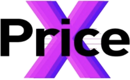
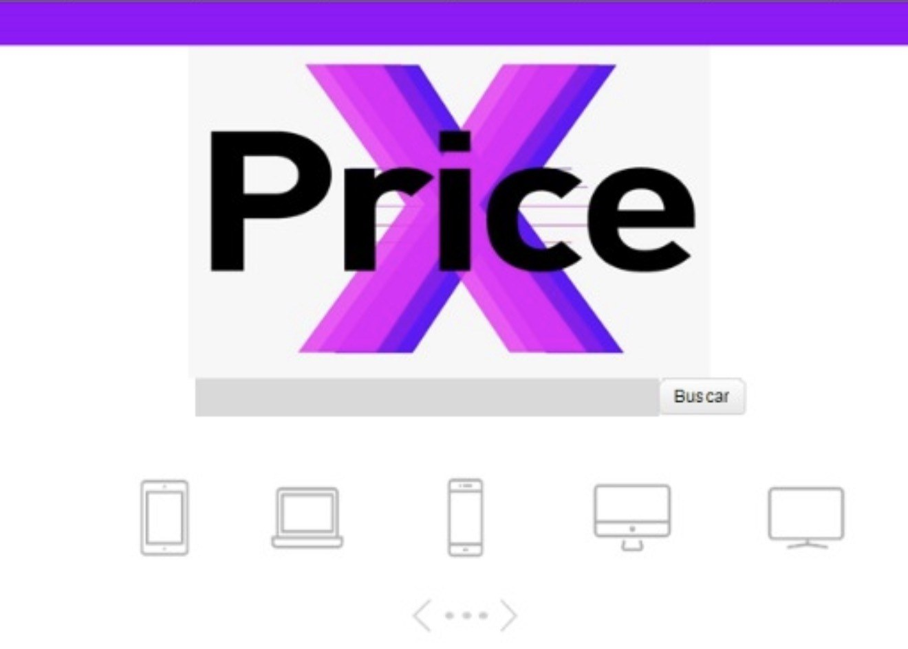
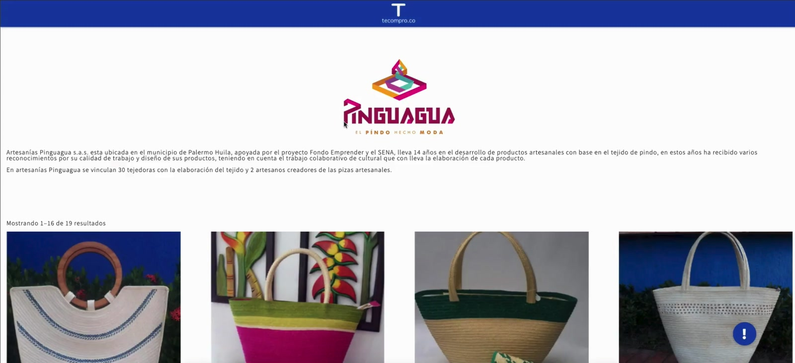
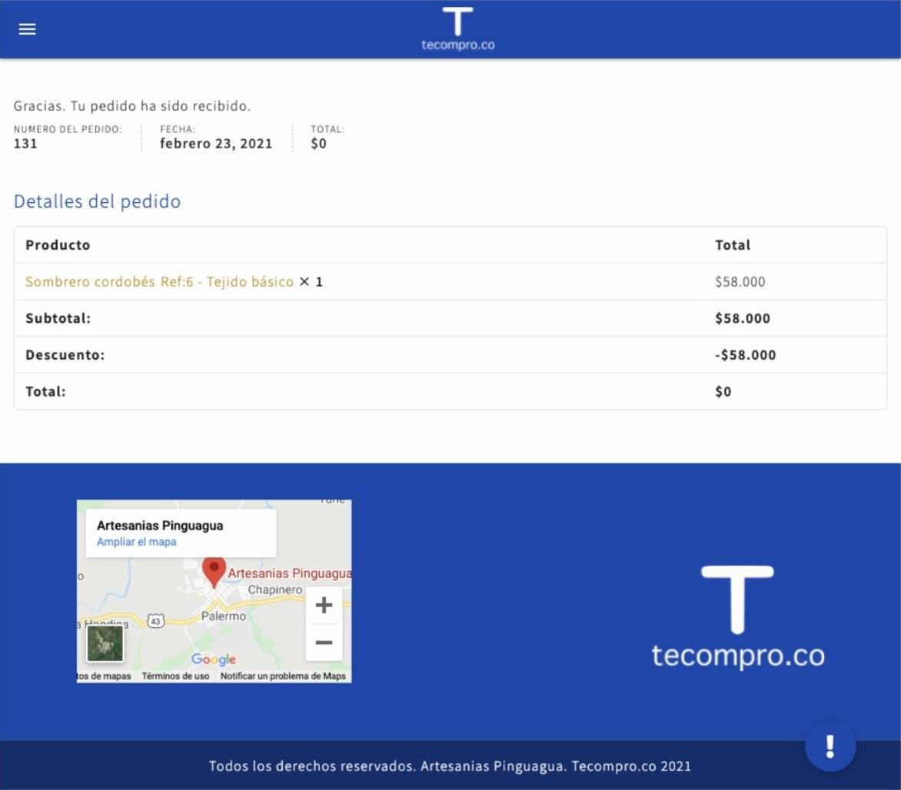
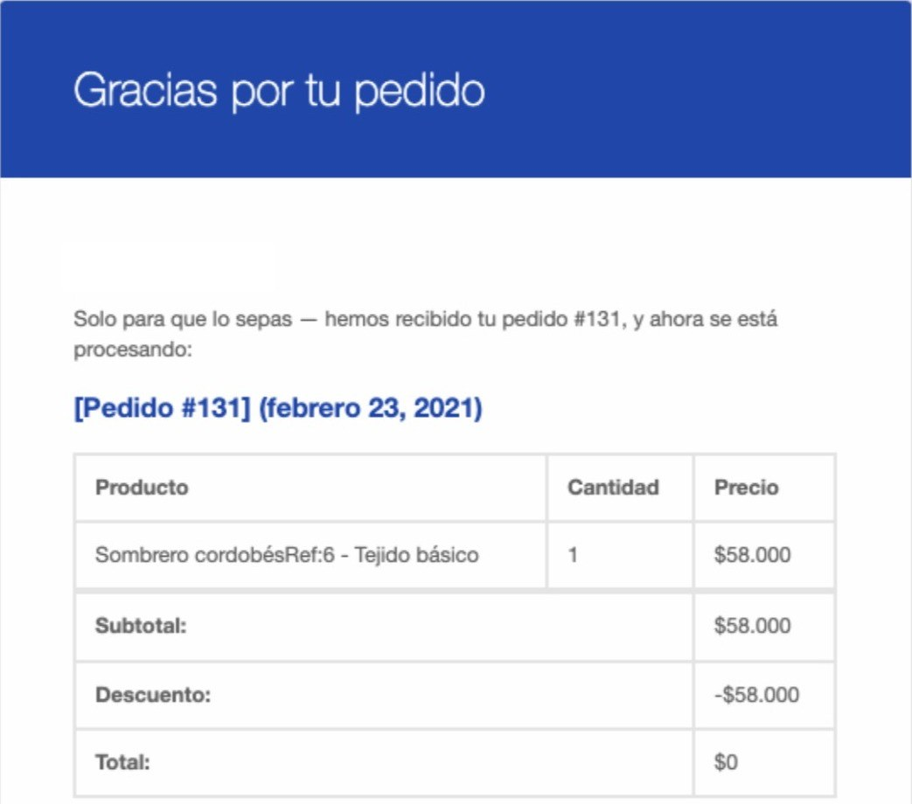

  
  &nbsp;&nbsp;&nbsp;
  

# De PriceX a Tecompro.co

**Dos emprendimientos digitales para el comercio colombiano · 2018–2024 · Cofundador**

Este repositorio cuenta la historia de dos productos que llevé al mercado y de las decisiones que tomé en el camino. No tiene código: Tecompro funcionaba sobre WordPress y los archivos de PriceX no se conservaron. Lo que sí tiene son los números que pesaron en cada decisión.

> **En corto:** PriceX comparaba precios de tecnología en grandes cadenas y salió al mercado como versión de prueba gratuita. Cuando las tiendas cambiaban sus enlaces, el programa dejaba de leer los precios, así que pedimos acceso directo a una gran cadena. Sus condiciones mostraron que una sola caída de diez minutos nos podía costar más de lo que dejaban cientos de ventas, y cerramos. Tecompro.co tomó lo aprendido y llevó página web, tienda en línea y cobro con QR a micronegocios. Llegó a unos 30 clientes con cerca de 100 puntos de venta, pero creció sin utilidad, y cerramos la sociedad en 2024.

## El caso en 2 minutos

Recreación animada y sin sonido, con la estructura de un pitch para cada empresa: problema, solución, ingresos, etapa, dificultad y aprendizaje.

https://github.com/user-attachments/assets/ab1add81-5beb-4a02-b98b-78568531993a

---

## 1. El origen: Inveniet (2018–2019)

La idea nació como mi proyecto de grado de Ingeniería Industrial, con línea de profundización en economía, en la Universidad Sergio Arboleda: un plan de negocios en el formato del Fondo Emprender del SENA, escrito con Camilo López. El proceso con el Fondo Emprender empezó en la sede principal del SENA en Neiva. Antes de construir nada encuestamos a 110 personas en el barrio Santa Bárbara (Usaquén, Bogotá):

- Más del 45 % pensó primero en tecnología cuando le preguntamos qué producto le interesaba, con el celular a la cabeza.
- La mayoría destinaba entre 2 y 5 millones de pesos al año a ese tipo de compras.
- El 74,5 % prefería comprar en tienda física. Por eso el producto no buscaba vender en línea, sino mostrar el mejor precio y llevar al cliente a la tienda.

## 2. PriceX (2018–2019): el comparador de precios

**Qué hacía.** Un programa recorría los catálogos en línea de tres grandes cadenas (la meta era llegar a cinco), organizaba los productos de electrónica y los ordenaba por precio. El ingreso iba a ser una comisión de entre el 1 y el 3 % por cada venta que llegara a la cadena desde PriceX.

**Hasta dónde llegó.** Salió al mercado como versión de prueba gratuita, financiada con recursos propios. La gente la usaba para comparar los productos que le interesaban.

**Mi papel.** Lideré el proyecto: estudio de mercado, modelo de negocio, conversaciones con las cadenas y análisis de viabilidad. El programa de captura de precios lo desarrolló el ingeniero Rafael Suárez.

**El problema técnico que lo desencadenó todo.** El programa encontraba cada producto siguiendo la estructura de los enlaces de cada tienda, y las tiendas la cambiaban constantemente: una ruta que funcionaba en las pruebas podía dejar de funcionar al día siguiente. Para tener datos estables decidimos pedirles acceso directo a las grandes superficies.

**La conversación que lo cambió todo.** La primera negociación fue con una de las cadenas más grandes del país, y nos explicaron que trabajaríamos con las mismas reglas que un proveedor:

1. **Pagos a 90 y hasta 180 días.** Veríamos cada comisión meses después de la venta.
2. **Responsabilidad por ventas perdidas.** A un proveedor que deja un estante vacío le cobran las ventas que se habrían hecho en ese tiempo. Con nosotros pasaría lo mismo: si algo de nuestra integración tumbaba su tienda en línea, aunque fuera por unos minutos, pagaríamos las ventas proyectadas de todo el país durante la caída.

**El cálculo**, con un artículo de ejemplo y cifras públicas de 2019:

| Concepto | Cifra |
|---|---|
| Precio del artículo | $500.000 |
| Comisión de PriceX en el mejor caso (3 %) | $15.000 |
| Ventas en línea de esa cadena | cerca de $500.000 millones al año: unos $57 millones por hora |
| Costo de una caída de 10 minutos en un momento normal | unos $10 millones, y mucho más en temporada alta |
| Ventas necesarias para pagar esa sola caída con comisiones | unas 670 |
| Caja para aguantar pagos a 90–180 días (presupuesto del plan: unos $26 millones al mes) | entre $78 y $156 millones |

Y ese riesgo se multiplicaba por cada cadena que consultaba el programa: una falla podía tumbar las tres a la vez, mientras la comisión seguía siendo la misma.

**La decisión.** Cerramos el proyecto. A la gente le gustaba la idea, y la versión de prueba lo confirmaba, pero el modelo ponía a la empresa a arriesgar millones para ganar miles, sin caja para esperar los pagos. El punto de quiebre no estaba en el producto sino en las condiciones del cliente que debía pagar, y solo apareció al negociar de verdad.

## 3. Tecompro.co (2019–2024): tiendas en línea y cobro con QR para micronegocios

**Cómo nació.** En 2019, en un evento del Fondo Emprender del SENA, me reencontré con Juan Carlos Rodríguez, amigo de infancia de Ibagué, que tenía una pequeña empresa de páginas web para emprendimientos. Le propuse unir las dos ideas: en vez de servir a las grandes cadenas, llevar la tecnología a los micronegocios. Empezamos de cero, con nombre nuevo.

**El problema.** Entre comisión y descuentos del banco, un datáfono se llevaba cerca del 3 al 5 % de cada venta, además de lo que costaba el equipo. Muchos negocios pequeños preferían no recibir pagos digitales.

**Qué ofrecíamos.**

- Página web y tienda en línea para cada comercio, con su propia dirección (WordPress multisitio).
- Cobro con un código QR impreso en un hablador en el punto de venta, sin datáfono, conectado a la pasarela de pagos ePayco.
- Control de inventario.
- La comparación de precios de PriceX como servicio adicional.

Así se veía la tienda de un cliente, Artesanías Pinguagua, de Palermo (Huila), en 2021:

Y un pedido de prueba, con la confirmación en la tienda y el correo automático al cliente:

  
  &nbsp;
  

**Mi papel.** Cofundador y responsable de producto. Propuse el modelo, definí el producto y sus flujos, e integré la pasarela de pagos, el inventario y los QR. Juan Carlos aportó la experiencia de su empresa de desarrollo web.

**Decisiones de producto.**

- **WordPress en lugar de desarrollo propio:** salir rápido, con poco presupuesto y un sitio independiente por comercio.
- **La pasarela de pagos:** con la más conocida del mercado la integración se volvió lenta y difícil; elegimos ePayco porque nos dio acompañamiento directo.
- **Crecer primero, cobrar después:** precios casi a pérdida y perfiles gratuitos para emprendimientos de la sede del SENA en Neiva y del programa de emprendimiento de la Universidad Sergio Arboleda, con quienes hicimos alianzas.
- **Un plan para negocios con varias sedes:** el plan normal costaba 50.000 pesos al mes por local; a quien tenía varias sedes le cobrábamos 30.000 por local. Un empresario con unos 20 locales en Bello (Antioquia) llegó a ser nuestro principal ingreso.

**Resultados.** Unos 30 clientes con cerca de 100 puntos de venta activos en Bogotá, Ibagué, Bello (Antioquia), el Huila (Neiva, Palermo y Acevedo) y unos pocos en el Eje Cafetero, entre Manizales y Pereira. Eran de sectores muy distintos: comidas rápidas, ópticas, ropa, artesanías, galerías de arte y servicios profesionales. Varios tenían más de un local, y cada local tenía su propio hablador con QR. Los que pagaban cubrían los costos de operación, pero no dejaban utilidad.

**Por qué cerró.**

- **Seguimos el modelo startup de la época: crecer primero y cobrar después.** Regalamos perfiles y cobramos casi a pérdida para mostrar tracción: visitas, comercios y productos publicados. Esas eran métricas de vanidad: subían, pero no se convirtieron en utilidad.
- El precio de entrada nunca se convirtió en un precio rentable.
- La pandemia nos golpeó fuerte y no supimos aprovechar el salto que dio el comercio electrónico.
- Fuerza comercial sí hubo; lo que nos faltó fue conocimiento y estrategia de negocio.
- Con los años, cada socio tuvo que buscar ingresos por fuera. En 2024 cerramos la sociedad de forma ordenada, con liquidación y reparto de activos.

Llegamos temprano: en 2019 casi nadie en Colombia pagaba con QR, y hoy, con Bre-B y las billeteras digitales, es cotidiano. Pero llegar temprano no sirve si no hay caja para esperar a que el mercado llegue.

## 4. Qué haría distinto

- **Validar el modelo de negocio con el cliente que paga, y que controla los datos, antes de construir.** En PriceX, la falla apareció en la primera negociación seria.
- **Crecer sin utilidad es coleccionar métricas de vanidad.** Desde el comienzo mediría cuatro números, y guardaría los registros: cuánto cuesta conseguir un comercio, cuánto deja al mes, cuántos pasan de gratis a pago y cuántos se van.
- **Mirar el peor caso, no solo el margen.** Una comisión pequeña frente a una responsabilidad sin tope es un mal negocio, aunque el producto guste.
- **Cobrar desde el primer día, aunque sea poco.** Un comercio que no paga no demuestra que el producto vale.

## 5. Universidad y alianzas

- La idea nació como proyecto de grado de Ingeniería Industrial en la Universidad Sergio Arboleda (2019).
- Tecompro participó en «Transforma Sueños en Empresa», el programa de aceleración empresarial de la Universidad Sergio Arboleda.
- Alianzas con la sede del SENA en Neiva y con el programa de emprendimiento de la Universidad Sergio Arboleda para entregar perfiles gratuitos de Tecompro a sus emprendedores.

**Entrevista del programa (2020).** Cuatro minutos sobre por qué decidí emprender, cómo surgió Tecompro.co, qué esperaba de ella, cómo viví el programa y qué le recomiendo a quien quiere emprender. Video de la Universidad Sergio Arboleda, publicado en su Instagram (@lasergioemprende).

https://github.com/user-attachments/assets/a47a38f1-cfea-4138-8373-12db0c4233d9

*Las cifras de Tecompro son aproximadas: los registros de la operación no se conservaron. Los precios del video son de ejemplo, salvo los de la tienda de Pinguagua.*

---

*Juan David Pachón Moya · [LinkedIn](https://www.linkedin.com/in/juan-david-pachon-moya-00554417b/)*
